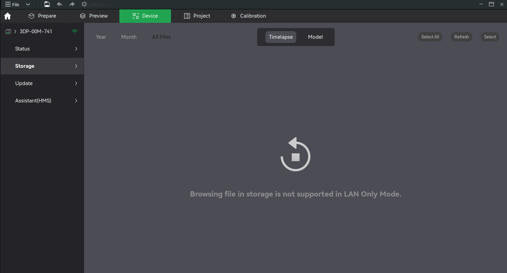
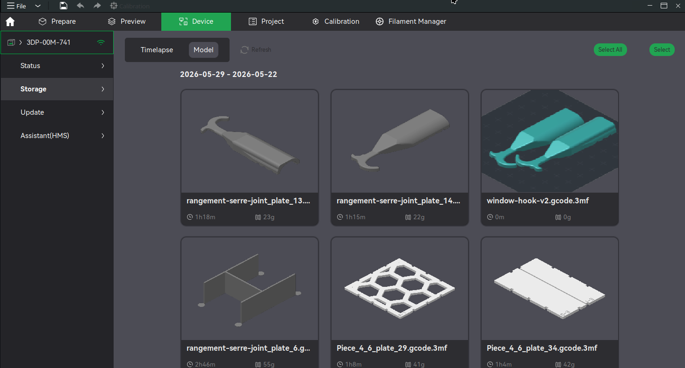

# BambuStudio-LAN-RESTORED

> **To Bambu Lab:** thanks for the 10/10 hardware. We'll take it from here. You're no longer involved.

A fork of [Bambu Lab's **BambuStudio**](https://github.com/bambulab/BambuStudio) that brings back
the **Storage** browser and **print-from-SD** when the printer runs in **LAN Only Mode**.

The official build disables SD-card access as soon as the printer is in LAN Only Mode. The Storage
tab only shows *"Browsing file in storage is not supported in LAN Only Mode."*:

<p align="center">
  
</p>

This fork talks to the printer's built-in **FTPS** server and local **MQTT** directly, so you can
list, preview, download, delete and **print** the files on the SD card, no cloud or internet required:

<p align="center">
  
</p>

## What's different from upstream

- **Browse / download / delete** Timelapse and Model files over FTPS in LAN Only Mode, with real
  thumbnails and a local cache.
- **Print from SD** over local MQTT: the `project_file` command is published directly with an
  `ftp://` URL the printer resolves itself, instead of the cloud-only path that fails in LAN Only Mode.
- **MCP server for AI agents**: Claude (or any MCP client) can drive the running Bambu Studio, see below.

## AI agents (MCP)

Bambu Studio can expose a [Model Context Protocol](https://modelcontextprotocol.io) server so that
agents act on the live GUI exactly like a user would (every change shows up on screen and can be undone).

### 1. Install

Download the AppImage from the [latest release](https://github.com/Glastis/BambuStudio-LAN-RESTORED/releases/latest)
(MCP is available from `v02.07.00.56-lan`), make it executable and run it:

```sh
chmod +x BambuStudio-LAN-RESTORED-*-x86_64.AppImage
./BambuStudio-LAN-RESTORED-*-x86_64.AppImage
```

Only Linux x86_64 is published; on other platforms build from source like upstream
(`BuildLinux.sh`, `BuildMac.sh`, `build_win.bat`).

### 2. Enable the server

In **Preferences**, tick **Allow AI agents to control Bambu Studio (MCP server)**. The server starts
immediately (no restart needed) and listens on `http://127.0.0.1:13619/mcp`, loopback only. The port can be
changed in the **MCP server port** field next to the checkbox.

Check that it answers:

```sh
curl -s http://127.0.0.1:13619/mcp -H 'Content-Type: application/json' \
  -d '{"jsonrpc":"2.0","id":1,"method":"tools/list"}' | head -c 300
```

The server only runs while Bambu Studio is open: start the application before your agent.

### 3. Connect your agent

**Claude Code:**

```sh
claude mcp add --transport http bambustudio http://127.0.0.1:13619/mcp
```

Add `--scope user` to make it available in every project, then check it with `claude mcp list` (or `/mcp`
inside a session).

**Clients that accept an HTTP server in their JSON config** (Cursor, VS Code, Windsurf...):

```json
{
  "mcpServers": {
    "bambustudio": { "type": "http", "url": "http://127.0.0.1:13619/mcp" }
  }
}
```

**Clients that only launch stdio servers** (e.g. Claude Desktop's `claude_desktop_config.json`) can go
through the [`mcp-remote`](https://www.npmjs.com/package/mcp-remote) bridge (requires Node.js):

```json
{
  "mcpServers": {
    "bambustudio": { "command": "npx", "args": ["-y", "mcp-remote", "http://127.0.0.1:13619/mcp"] }
  }
}
```

### Optional: bearer token

Any local process can reach the port. To require a token, close Bambu Studio and add
`"mcp_server_token": "<secret>"` to `BambuStudio.conf` (`~/.config/BambuStudio/` on Linux,
`%APPDATA%\BambuStudio\` on Windows, `~/Library/Application Support/BambuStudio/` on macOS). Clients then
send `Authorization: Bearer <secret>`:

```sh
claude mcp add --transport http bambustudio http://127.0.0.1:13619/mcp --header "Authorization: Bearer <secret>"
```

(`"headers": {"Authorization": "Bearer <secret>"}` in JSON configs, `--header "Authorization: Bearer <secret>"`
after the URL for `mcp-remote`.) Requests carrying a non-local `Origin` header are always rejected, so web
pages open in your browser cannot drive the server.

### Usage

Just ask in plain language, the agent picks the tools. For example:

- *"Import ~/models/bracket.stl, lay it on its largest face and scale it to 120 %."*
- *"Arrange plate 1, use 0.16 mm layers with tree supports only on the bracket, then slice and tell me
  the print time and filament usage."*
- *"Paint the seam on the back of the object and export the plate to ~/out/bracket.gcode.3mf."*
- *"What is my X1C doing? Pause it if the nozzle temperature is below 200 °C."*

Tools never display dialogs: the choices Bambu Studio would ask the user are explicit tool arguments
(`discard_changes`, `unsaved_changes`, `run_post_process_scripts`...). Any other prompt raised internally is
answered automatically (OK for information, Cancel/No for questions) and its text is returned to the agent.
Every edit goes through the regular undo stack, so **Ctrl+Z** reverts what the agent did.

| Area | Tools |
| --- | --- |
| Project | `get_app_state`, `new_project`, `open_project`, `save_project`, `import_models`, `undo`, `redo`, `screenshot` |
| Plates | `list_plates`, `add_plate`, `delete_plate`, `select_plate`, `rename_plate` |
| Objects | `list_objects`, `get_object`, `select_objects`, `transform_object` (move/rotate/scale/mirror), `move_to_plate`, `rename_object`, `duplicate_object`, `delete_objects`, `arrange`, `auto_orient` |
| Settings | `search_settings`, `get_settings`, `set_settings` (global or per object/part, e.g. supports), `list_presets`, `select_preset` |
| Filaments | `list_filaments`, `set_filament`, `add_filament`, `remove_filament`, `assign_filament` |
| Painting | `paint_facets` (seams, supports, fuzzy skin, colours, by brush stroke / sphere / box / facing direction), `clear_painting`, `paint_info` |
| Slicing | `slice`, `get_slice_result`, `export_gcode`, `export_sliced_3mf` |
| Printers | `list_printers`, `get_printer_status` (job, temperatures, AMS, HMS), `select_printer`, `printer_control` (pause/resume/stop/light) |

## On security

Don't trade freedom for so-called security.

It makes a convenient excuse for keeping control over how a product is used, but forcing people to
export their data and to expose more and more hardware to the internet has never been about security.

A machine fully disconnected from the internet will always be more secure than one that isn't.

How are the most sensitive projects handled? On an internet-facing cloud? No. On a local network,
completely cut off from the rest. A smaller attack surface means lower risk.

You don't need to lock your door if you live on the moon.
